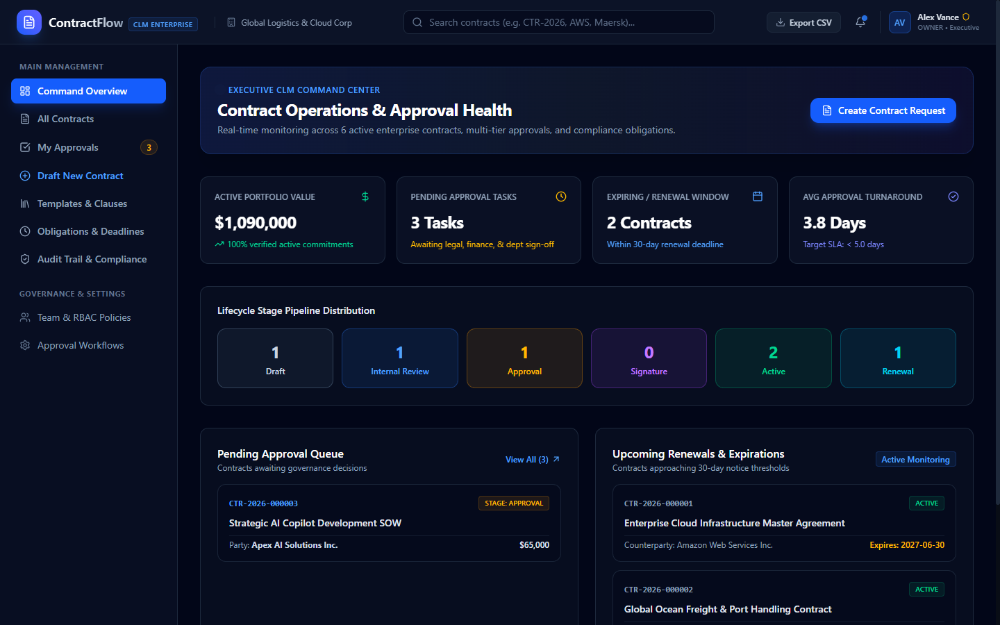
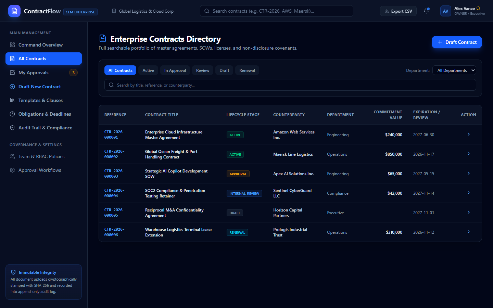
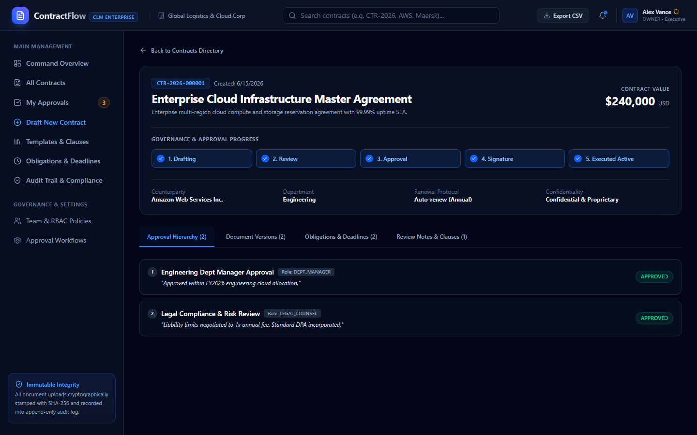
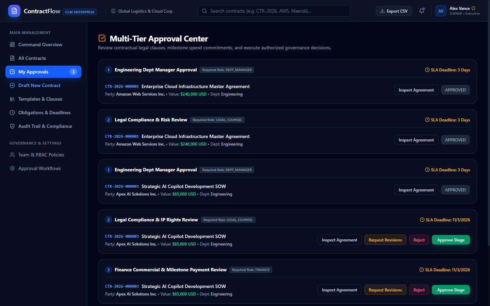
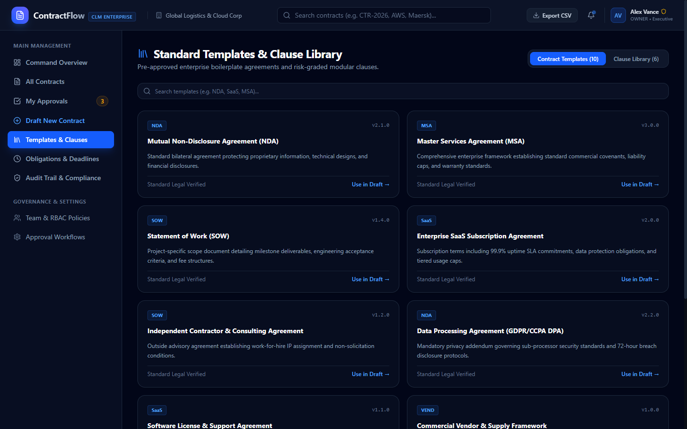

# ContractFlow — Contract Lifecycle & Approval Management

> **Enterprise Open-Source Contract Lifecycle Management (CLM) & Governance Automation Platform.**

[](LICENSE)
[](https://fastapi.tiangolo.com/)
[](https://react.dev/)
[](https://tailwindcss.com/)
[](https://www.postgresql.org/)
[](apps/api/tests/)

---

## 📸 Application Showcase

### Executive CLM Command Center & Portfolio Valuation


### Comprehensive Enterprise Contracts Directory & Lifecycle Filtering


### Detailed Agreement Overview & 5-Stage Stepper Governance


### Multi-Tier Approval Center with Conflict-of-Interest Prevention


### Pre-Approved Boilerplate Templates & Standard Clause Library


---

## 🚀 Key Features

- **Multi-Tenant Organization Isolation:** Strict tenant separation enforced on all database queries.
- **Contract Lifecycle State Machine:** Valid transitions across `DRAFT` → `INTERNAL_REVIEW` → `APPROVAL` → `NEGOTIATION` → `SIGNATURE` → `ACTIVE` → `RENEWAL` → `ARCHIVED`.
- **Concurrency-Safe Reference Generation:** Automated unique numbering (`CTR-YYYY-XXXXXX`).
- **Multi-Tier Sequential & Parallel Approval Workflows:** Dynamic routing based on contract value (Dept Manager, Legal Counsel, Finance, Executive).
- **Conflict of Interest Prevention:** Requesters are blocked from approving their own submissions.
- **Cryptographic Document Stamping:** Every uploaded document is fingerprinted with an immutable **SHA-256 hash**.
- **Pre-Approved Boilerplate Catalog (10 Standard Contracts):** Includes Mutual NDA, Master Services Agreement (MSA), Statement of Work (SOW), Enterprise SaaS Agreement, Contractor Agreement, Data Processing Agreement (DPA), Software License, Commercial Vendor Agreement, Executive Employment, and Joint Venture Agreement.
- **Reusable Legal Clause Library:** Pre-vetted clauses (Liability Caps, Mutual Confidentiality, Delaware Arbitration, IP Assignment, Unlimited Indemnity) with risk rating indicators.
- **Contractual Obligations & Deadlines:** Overdue tracking, milestone recurrence, and compliance checklists.
- **Append-Only Tamper-Evident Audit Trail:** Immutable records of all actions, actors, timestamps, and state changes.
- **Data Export:** Instant CSV streaming of authorized contracts.

---

## 🛠️ Technology Stack

| Layer | Technologies |
|---|---|
| **Frontend** | React 19, TypeScript, Vite, Tailwind CSS v4, Lucide Icons |
| **Backend** | Python 3.12+, FastAPI, SQLAlchemy 2.0 ORM, Pydantic v2, PyJWT, Bcrypt |
| **Database** | PostgreSQL 16 (Production) / Standalone SQLite (Zero-Dependency Local Dev) |
| **Testing** | Pytest, FastAPI TestClient, HTTPX |
| **DevOps** | Docker, Docker Compose, Multi-Stage Builds, Nginx Alpine |

---

## 🔑 Demo Access Credentials

The deterministic database seed comes pre-configured with sample enterprise users:

| Role | Email Address | Password | Permissions |
|---|---|---|---|
| **Owner / Executive** | `admin@contractflow.org` | `AdminPass123!` | Full system governance & executive approvals |
| **Legal Counsel** | `legal@contractflow.org` | `LegalPass123!` | Legal reviews, clause approval, risk assessment |
| **Department Manager** | `manager@contractflow.org` | `ManagerPass123!` | Departmental approvals & requisition review |
| **Finance Officer** | `finance@contractflow.org` | `FinancePass123!` | Commercial review, budget commitment approvals |
| **Contract Requester** | `requester@contractflow.org` | `RequestPass123!` | Contract drafting, version submission |
| **Auditor / Compliance** | `auditor@contractflow.org` | `AuditPass123!` | Read-only compliance audit & export access |

---

## ⚡ Quick Start (Local Development)

### 1. Prerequisites
- Python 3.11+
- Node.js 20+ and npm

### 2. Backend Setup
```bash
cd apps/api

# Create and activate virtual environment
python -m venv .venv
source .venv/bin/activate  # On Windows: .venv\Scripts\activate

# Install dependencies
pip install -r requirements.txt

# Run deterministic database seed
python seed.py

# Start REST API server (runs on port 8000)
uvicorn app.main:app --host 127.0.0.1 --port 8000 --reload
```
Interactive OpenAPI/Swagger documentation is available at: **http://127.0.0.1:8000/docs**

### 3. Frontend Setup
```bash
cd apps/web

# Install frontend dependencies
npm install

# Start Vite dev server (runs on port 5185)
npm run dev
```
Open **http://localhost:5185** in your browser.

---

## 🐳 Docker Deployment

Run the complete production stack (PostgreSQL 16, FastAPI Backend, and Nginx React Frontend):

```bash
docker compose up -d --build
```

Access services:
- Web Application: **http://localhost:3000**
- API & Docs: **http://localhost:8000/docs**
- PostgreSQL: **localhost:5432**

---

## 🧪 Automated Test Suite

Run the backend test suite:
```bash
cd apps/api
pytest tests/test_api.py -v
```
Test results:
```
tests/test_api.py::test_health_check PASSED                              [ 11%]
tests/test_api.py::test_auth_login_success PASSED                        [ 22%]
tests/test_api.py::test_auth_login_invalid_password PASSED               [ 33%]
tests/test_api.py::test_contract_list_authenticated PASSED               [ 44%]
tests/test_api.py::test_contract_creation_and_reference_generation PASSED [ 55%]
tests/test_api.py::test_submit_approval_workflow PASSED                  [ 66%]
tests/test_api.py::test_approval_decision_requires_rationale PASSED      [ 77%]
tests/test_api.py::test_templates_and_clauses_listing PASSED             [ 88%]
tests/test_api.py::test_dashboard_metrics_and_csv_export PASSED          [100%]
======================= 9 passed in 7.46s =======================
```

---

## 📄 Repository Details

- **GitHub Repository:** [https://github.com/0xyz-exe/contractflow](https://github.com/0xyz-exe/contractflow)
- **Clone with HTTPS:** `git clone https://github.com/0xyz-exe/contractflow.git`
- **Clone with SSH:** `git clone git@github.com:0xyz-exe/contractflow.git`
- **License:** MIT License
